# Universal Remote

An ad-free, account-free Android remote for everything with an infrared remote: TVs, soundbars,
receivers, projectors, cable boxes, streaming boxes, Blu-ray players, air conditioners, fans,
heaters and LED lights. Smart TVs and streaming boxes can also be controlled over Bluetooth,
with your phone acting as a keyboard, touchpad and media remote.

No ads. No tracking. No accounts. **No internet permission at all**, so the app cannot send
anything off your phone.

  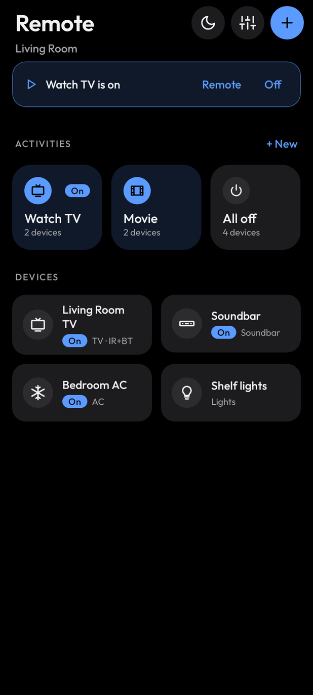
  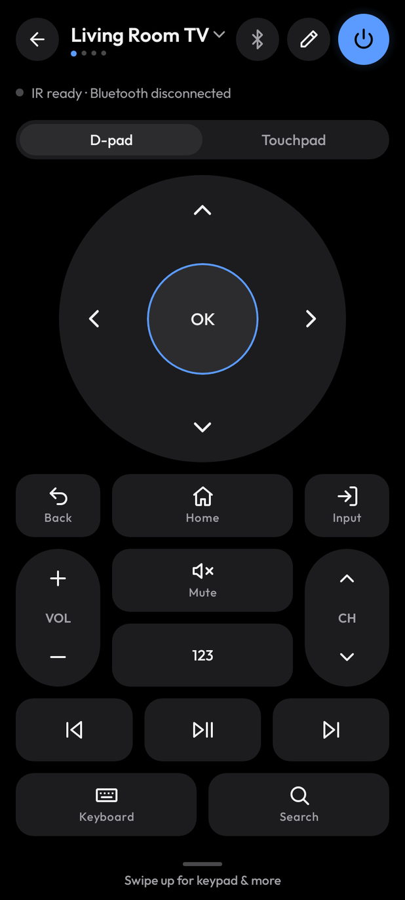
  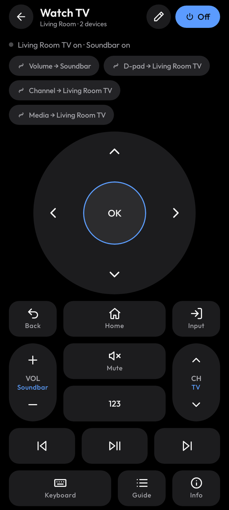

## Download

**[Download universal-remote.apk (v0.9.0)](https://github.com/SwiftReason/universal-remote-app/releases/download/v0.9.0/universal-remote.apk)** · [All releases](https://github.com/SwiftReason/universal-remote-app/releases)

1. On your phone, open the link above and tap `universal-remote.apk`.
2. Open the downloaded file. Android asks once to allow installs from your browser or Files app.
3. Open Universal Remote and tap **+ → Add device**.

**Requirements**

- Android 8.0 or newer.
- For infrared: a phone with a built-in IR blaster (for example the OnePlus 13R, many Xiaomi,
  Redmi and POCO phones, and some Huawei, Honor and Vivo models).
- For Bluetooth remote mode: Android 9 or newer, and a phone maker that allows apps to act as a
  Bluetooth keyboard (most do).

Phones without an IR blaster can still use the Bluetooth features.

> **Version 0.9.0 is an early pre-release.** It passes its full automated test suite but hasn't
> been tested on real hardware yet. If something doesn't work, Settings → Diagnostics shows exactly
> what the phone reports and what was sent.

## Features

### Works with almost any IR device, offline

- A built-in code database of **1,736 remotes and 31,717 codes from 803 brands**, covering TVs,
  soundbars and speakers, AV receivers, projectors, cable and satellite boxes, streaming boxes,
  Blu-ray/DVD players, air conditioners, fans, air purifiers and heaters, LED lighting, cameras
  and more. It's built from the community [Flipper-IRDB](https://github.com/Lucaslhm/Flipper-IRDB)
  and ships inside the app, so nothing is downloaded.
- Every common IR protocol: Sony SIRC (12, 15 and 20-bit), NEC, NEC extended, NEC42, Samsung,
  Philips RC5, RC5X and RC6, Panasonic (Kaseikyo), RCA and Pioneer, plus raw captures. The
  encoders are checked against the Flipper Zero's own reference signals.
- Hold any volume, channel, arrow or brightness button to repeat, using each protocol's proper
  repeat signal.

### Setup that finds the right codes for you

- Pick the kind of device, then the brand (with search).
- The app tests the most common remotes for that brand one at a time: it sends a test button
  (Power for a TV, Vol + for a soundbar, and so on) and asks *Did it respond?* Answer
  Yes, No or Send again. A second button confirms the match before it's saved.
- **Don't know the brand?** Scan mode sends the test code for every brand, one per second, with a
  big Stop button. It then offers the last few codes it sent so you can pick the one that worked.
- Name the device and choose a room. It gets a layout designed for its type.
- Smart TVs and streaming boxes can also be paired over Bluetooth during setup, or added as
  Bluetooth-only devices.

### A remote designed for each kind of device

| Device | What you get |
|---|---|
| TV | Big D-pad, Back · Home · Input, volume and channel rockers, Mute, a number keypad, and media keys when paired over Bluetooth |
| Soundbar / speaker | Large volume rocker, Mute, Bass and Subwoofer ±, input chips (TV, HDMI, Bluetooth, Optical, AUX) and sound modes |
| AV receiver | Volume, a grid of every input, surround modes, Zone 2 when available, menu navigation |
| Projector | Input, Menu, D-pad, Keystone, Focus and Zoom. Power off is confirmed and sent twice, as most projectors need |
| Cable / satellite box | D-pad, Guide, channel rocker, keypad and DVR controls (record, play, rewind, fast-forward) |
| Streaming box | D-pad, Back and Home, media row, app shortcuts |
| Blu-ray / DVD | Transport row, D-pad, Disc menu, Pop-up menu and Eject |
| Air conditioner | A thermostat (see below) |
| Fan / purifier / heater | Speed ± (or a single Speed button), Oscillate, Timer, Mode |
| LED lights | On/Off, brightness, a grid of color swatches and effect modes (flash, fade, smooth, strobe) |
| Anything else | Every button from its remote, ready to arrange |

### The remote screen

- **D-pad or touchpad**: swipe on the touchpad for arrows, tap for OK, swipe and hold to repeat.
  The choice is remembered per device.
- A status line confirms every press: *Sent · Vol + (IR)*.
- Haptic feedback and a press animation on every button.
- Your phone's **volume buttons** control the device while its remote is open (can be turned off).
- **Swipe left and right** to switch between devices in the same room, or use the name dropdown.
- Swipe up for the **keypad sheet**: digits, dash, Enter, Guide, Info, Subtitles and Settings.
- The screen stays on while a remote is open (optional).

### Make every remote your own

- Tap the pencil, or long-press empty space, to edit a layout.
- **Drag** buttons to move them (they snap to the grid and push others aside), **resize** from the
  corners, and remove them with the red badge.
- **Add** any button the device's remote supports, a D-pad or touchpad, rockers, a keypad, a media
  row or a Bluetooth keyboard button.
- **Custom code** button: search the whole database for any code, or enter a protocol, address and
  command yourself. Test it, label it and place it.
- Choose, per button, whether it is sent over IR or Bluetooth.
- Undo any change, or reset to the default layout.

### Bluetooth remote mode for smart TVs

Your phone pairs with the TV as a Bluetooth keyboard, mouse and media remote, with no extra
hardware and no internet.

- D-pad, OK, Back, Home and media keys over Bluetooth.
- **Type on the TV** with your phone's keyboard: search boxes, passwords, anything.
- **Touchpad pointer**: drag to move a real pointer (with acceleration), tap to click, two-finger
  drag to scroll.
- Smart routing: Power and Input stay on IR, because a TV's Bluetooth is usually asleep when the
  TV is off. Navigation and media use Bluetooth when connected and fall back to IR. Volume uses
  IR by default and can be switched to Bluetooth.
- The connection survives screen-off and switching apps; a notification has a Disconnect button.

| TV or box | Bluetooth support |
|---|---|
| Google TV / Android TV (Sony Bravia, Chromecast with Google TV, Nvidia Shield) | Full: navigation, media, typing, pointer |
| Fire TV | Navigation, media, typing |
| Samsung (Tizen), LG (webOS) | Keyboard and pointer; some keys differ by brand |
| Apple TV | Keyboard and media keys |
| Roku | Not supported (Roku doesn't accept Bluetooth keyboards); use IR |

### Activities: one tap for several devices

- **"Watch TV"** can turn on the TV and soundbar and switch to HDMI 2 in one tap. After you add a
  second device to a room, the app offers a ready-made Watch TV activity.
- Each activity gets **one combined remote**: volume goes to the soundbar, the D-pad to the TV,
  channels to the cable box. Every rocker shows which device it controls.
- Uses dedicated on/off codes when the remote has them. Otherwise it tracks whether each device
  is probably on, so running an activity twice never toggles your TV off.
- A banner shows progress (*Turning on Soundbar…*) with Cancel, and *Watch TV is on* afterwards,
  with quick Remote and Off buttons.
- **All off** for every room. **Fix device states** when the app's idea of what's on gets out of sync.
- Build your own: pick devices, record steps by tapping buttons, set delays with sliders, choose
  which device gets volume, D-pad, channels and media, then Test and Save.

### Air conditioners

AC remotes send the whole state with every press, so the app shows a thermostat instead of buttons:

- A big temperature with ± (hold to step quickly), mode chips (Cool, Heat, Dry, Fan, Auto), fan
  speed chips and a Swing toggle.
- It only offers combinations your AC's codes actually include. Anything else is greyed out
  rather than silently ignored.
- Celsius or Fahrenheit, plus presets such as *Max cool* or *Dry* when the remote has them.
- *Last sent: Cool · 72° · Fan auto*, since infrared has no way to report back.

### Lights, fans and the home screen

- Lights and fans remember what was last sent (color, brightness, speed).
- **Rooms** as tabs you can swipe between, with activity cards and a device grid showing which
  devices are on.
- Opens straight to your last-used remote (optional).

### Quick Settings tiles and widgets

- Three Quick Settings tiles that run your favorite activities, plus a Power tile for the
  last-used device. They work from the lock screen.
- **Activities widget** with one-tap activity buttons.
- **Mini remote widget** with Power, Vol −, Vol + and Mute for the device you choose.

### Sleep timer

"Turn everything in this room off in 30 minutes" (15, 30, 60 or 90). It runs with the screen off;
keep the phone where its IR can reach the devices.

### Backup without the cloud

Export your whole setup (rooms, devices, layouts, activities) to a JSON file, share it with the
share sheet, and import it on another phone.

### Look and diagnostics

- True-black dark theme for OLED screens, four accent colors (blue, orange, green, purple) and the
  Outfit typeface.
- **Diagnostics** shows what Android reports about the IR blaster (the step-by-step detection
  result and the supported carrier frequencies), the exact signal of the last buttons sent (copyable),
  a Sony test pad and a Bluetooth keyboard test.

## More screenshots

  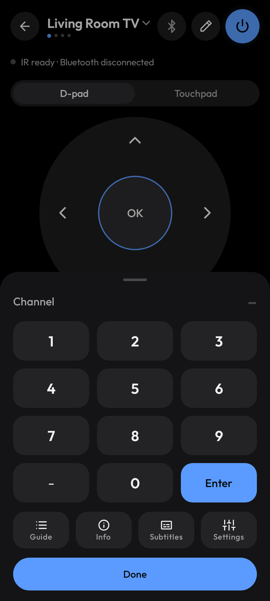
  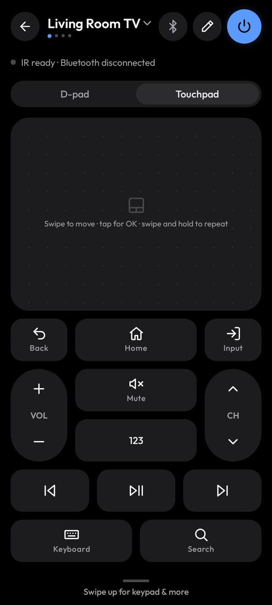
  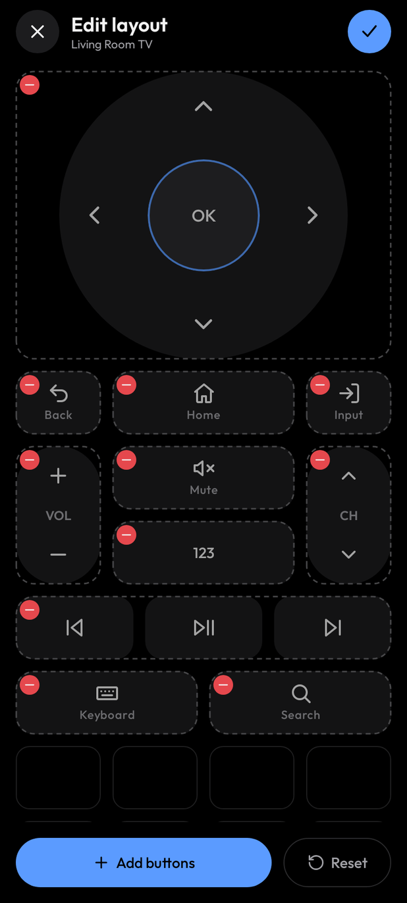
  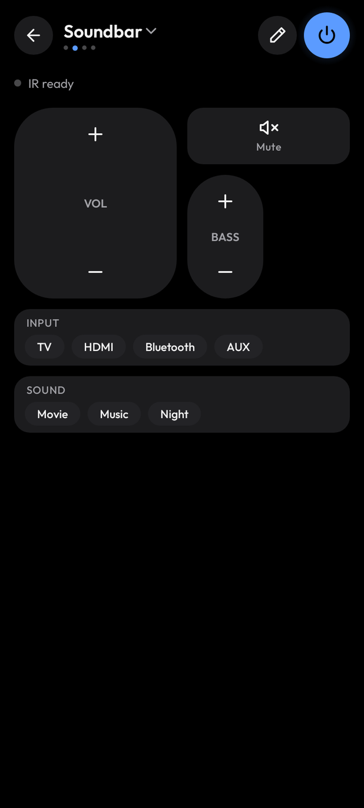

  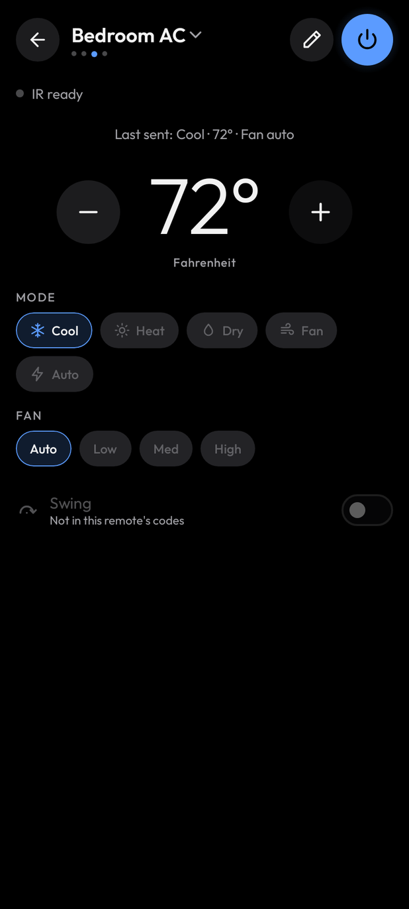
  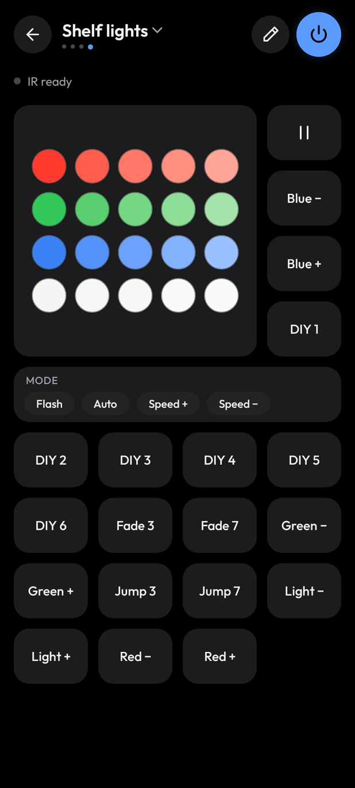
  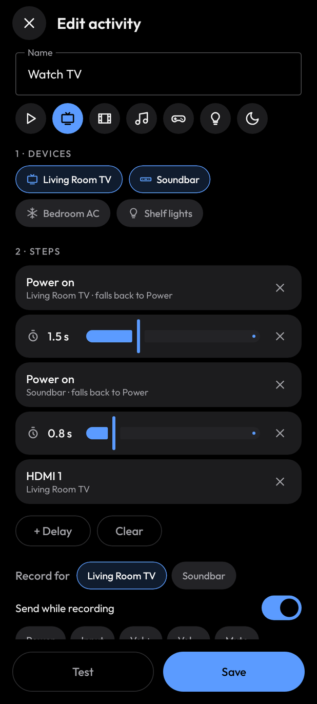
  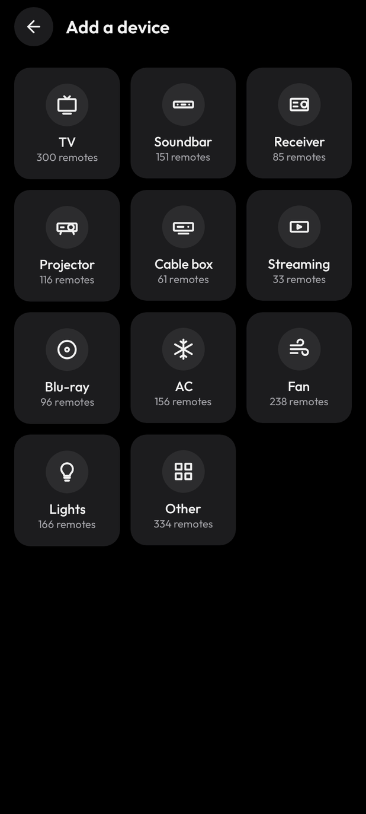

## Privacy and permissions

The app has **no internet permission**. Android won't let it open any network connection, so
there are no ads, no analytics, no crash reports, no accounts and no cloud. Your setup stays on
your phone and in any backup file you export yourself.

| Permission | Why |
|---|---|
| Transmit infrared | Send IR codes from the phone's IR blaster |
| Nearby devices (Bluetooth connect / advertise) | Pair with and control TVs as a Bluetooth keyboard and remote. Only asked for when you use Bluetooth |
| Foreground service (connected device) | Keep the Bluetooth link alive with the screen off, and run the sleep timer |
| Notifications | Show the Bluetooth / sleep timer notification with its Disconnect button |
| Wake lock | Let the sleep timer fire with the screen off |
| Run at startup | Used by Android's widget library to restore widgets after a reboot |

## Known limitations

- **Pre-release**: not yet tested on real phones and TVs.
- Codes come from a community database, so some models may not match. The setup test loop and
  scan mode exist for exactly that.
- The app can't learn codes from an existing remote (phone IR blasters only transmit).
- No Wi-Fi control of smart TVs. That would need the internet permission, which the app deliberately doesn't have.
- No iPhone version: iPhones have no IR blaster.

## Credits and licenses

- IR codes: [Flipper-IRDB](https://github.com/Lucaslhm/Flipper-IRDB), CC0 1.0 (public domain).
- Typeface: [Outfit](https://github.com/Outfitio/Outfit-Fonts), SIL Open Font License 1.1 (included in the app).
- Built with Kotlin, Jetpack Compose, Room and Glance (Apache License 2.0).

This repository hosts the app's releases and documentation; the source code isn't public.
